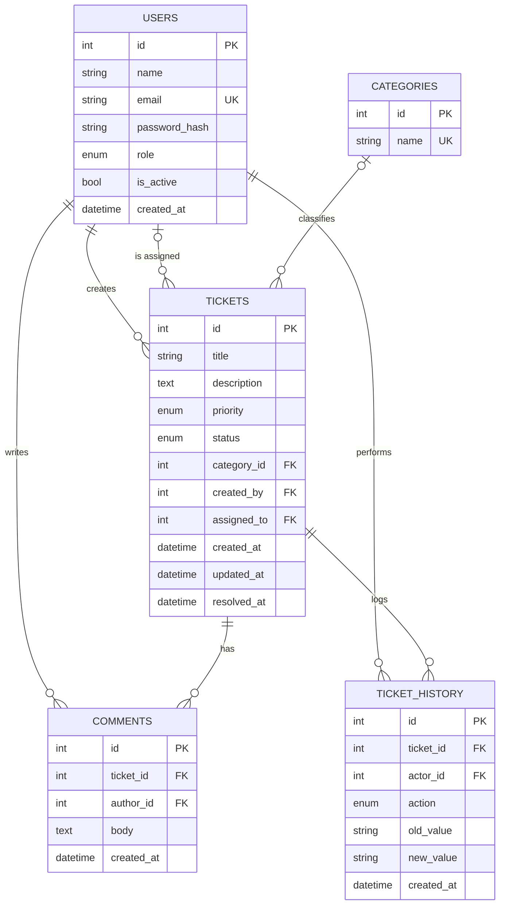

# Database Design

MySQL 8, InnoDB, utf8mb4. The real schema is created by Alembic migrations;
`schema.sql` is the reference.

## ERD

## Design decisions
1. **Ticket number:** `TKT-0001` is derived from `tickets.id` in the API
   (`f"TKT-{id:04d}"`). No second column to keep in sync.
2. **Role as ENUM** (employee, agent, admin). Three fixed roles do not need a
   roles table. If roles become configurable later, migrate to a table.
3. **Users are deactivated, never deleted** (`is_active`). Deleting a user would
   break tickets, comments and the audit trail. Foreign keys use RESTRICT.
4. **`ticket_history` is append-only.** The API has no update or delete for it.
5. **Comments cascade-delete with their ticket;** history does not exist without it either.
6. **Indexes** on the columns we filter and sort by: status, priority,
   assigned_to, created_by, created_at.
7. **Passwords:** only `password_hash` is stored.
8. **Later phase tables (not in MVP):** attachments, monitored_hosts, host_checks.

## Status transitions
| From | Allowed to |
|---|---|
| Open | In Progress |
| In Progress | Resolved, Open |
| Resolved | Closed, Open (reopen) |
| Closed | none |